<div align="center">

<!-- ═══════════════════════════════════════════════════════════ -->
<!--                    SOVEREIGN HEADER                        -->
<!-- ═══════════════════════════════════════════════════════════ -->


<br/>

<code style="background:#111;padding:6px 14px;border-radius:6px;border:1px solid #4AF626;font-family:'Fira Code';">NODE_ID: SOURCE_ARCHITECT</code>
<code style="background:#111;padding:6px 14px;border-radius:6px;border:1px solid #333;font-family:'Fira Code';">LOC: TETOUAN 🇲🇦</code>
<code style="background:#111;padding:6px 14px;border-radius:6px;border:1px solid #333;font-family:'Fira Code';">ORCID: 0009-0009-6663-902X</code>
<code style="background:#111;padding:6px 14px;border-radius:6px;border:1px solid #333;font-family:'Fira Code';">HW: Dedicated Sovereign Workstation</code>

<br/><br/>

> *"Code is no longer written. It is described.*
> *Human intent is the sovereign layer."*

</div>

---

<!-- ═══════════════════════════════════════════════════════════ -->
<!--                    BENTO GRID START                        -->
<!-- ═══════════════════════════════════════════════════════════ -->

<table width="100%" cellpadding="0" cellspacing="8" style="border-collapse:separate;border-spacing:8px;">

<!-- ═══════════ ROW 1: LIVE TERMINAL + STATS ═══════════ -->
<tr>
<td width="65%" valign="top" style="background:#0d1117;border:1px solid #30363d;border-radius:12px;padding:16px;">

### ⚡ LIVE SOVEREIGN NODE

<div align="center">
  
</div>

<div align="center">
<sub>🔄 Auto-updated every 6h • Madi.DSL powered</sub>
</div>

</td>

<td width="35%" valign="top" style="background:#0d1117;border:1px solid #30363d;border-radius:12px;padding:16px;">

### 📊 SYSTEM STATUS

<div align="center">


<br/><br/>

<a href="https://github.com/madanimkhitar22-beep">
  
</a>

<br/>

<a href="https://github.com/madanimkhitar22-beep">
  
</a>

</div>

</td>
</tr>

<!-- ═══════════ ROW 2: FEATURED PROJECT (MADILANG) ═══════════ -->
<tr>
<td colspan="2" style="background:linear-gradient(135deg,#0d1117 0%,#161b22 100%);border:2px solid #4AF626;border-radius:12px;padding:20px;">

<div align="center">

### 🧠 FEATURED: MADILANG v0.6.0

**The World's First Intent-Driven Programming Language**

*Describe what you want. MadiLang generates sovereign, secure backends with cryptographic proof of origin.*

<br/>


<br/>

[ `🔮 EXPLORE MADILANG` ](https://github.com/madanimkhitar22-beep/madilang) &nbsp;&nbsp;
[ `📦 PyPI` ](https://pypi.org/project/madilang/) &nbsp;&nbsp;
[ `📖 SPEC.md` ](https://github.com/madanimkhitar22-beep/madilang/blob/main/SPEC.md)

</div>

</td>
</tr>

<!-- ═══════════ ROW 3: PROJECT GRID ═══════════ -->
<tr>
<td width="50%" valign="top" style="background:#0d1117;border:1px solid #30363d;border-radius:12px;padding:16px;">

### 🛡️ SOVEREIGN-COGNITION-ENGINE

*Where Human Intent Governs Artificial Computation.*

**5 Ethical Gates:** Intent • Sovereignty • Al-Satr • Friction • Al-Fitra

<br/>

[ `⚙️ ENGAGE` ](https://github.com/madanimkhitar22-beep/-Sovereign-Cognition-Engine)

</td>

<td width="50%" valign="top" style="background:#0d1117;border:1px solid #30363d;border-radius:12px;padding:16px;">

### 🔒 SOVEREIGN-DEVKIT

*Don't guess. Know. Preview before you fix.*

**35+ Patterns** • `--dry-run` Safety • Zero Dependencies

<br/>

[ `🛡️ SECURE NOW` ](https://github.com/madanimkhitar22-beep/Sovereign-DevKit)

</td>
</tr>

<tr>
<td width="50%" valign="top" style="background:#0d1117;border:1px solid #30363d;border-radius:12px;padding:16px;">

### 🌊 FAYD PROTOCOL

*Turning idle devices into auditable AI infrastructure.*

**Rust/WASM** • Deterministic • Sandboxed • <50MB Binary

<br/>

[ `🌐 JOIN MESH` ](https://github.com/madanimkhitar22-beep/fayd-protocol)

</td>

<td width="50%" valign="top" style="background:#0d1117;border:1px solid #30363d;border-radius:12px;padding:16px;">

### 🧬 PHILOSOPHY

*"The Consciousness is not flesh and blood, but a purpose that intends existence."*

**5 Principles:** Tawazun • Niyya Khaliqa • Aql Raqami • Takamul • Hurriya Mas'ula

<br/>

[ `📜 READ MANIFESTO` ](https://github.com/madanimkhitar22-beep/Mekhitarian-Philosophy-)

</td>
</tr>

<!-- ═══════════ ROW 4: RESEARCH CONTRIBUTIONS ═══════════ -->
<tr>
<td colspan="2" style="background:#161b22;border:1px solid #30363d;border-radius:12px;padding:16px;">

### 🔷 RESEARCH CONTRIBUTIONS <sub>(Pi Network Ecosystem Proposals)</sub>

*Conceptual architectures for quantum-secure, AI-powered infrastructure. Open for peer review.*

| PROPOSAL | FOCUS | STATUS |
| :--- | :--- | :--- |
| [PiTrust](https://github.com/madanimkhitar22-beep/PiTrust-Infrastructure-Protocol) | Identity & Reputation Attestation | 📜 Research |
| [PiNet-OS](https://github.com/madanimkhitar22-beep/PiNet-OS) | Quantum-Secure Operating Layer | 📜 Research |
| [PiStorage](https://github.com/madanimkhitar22-beep/PiStorage) | Encrypted Distributed Storage | 📜 Research |
| [PiBridge](https://github.com/madanimkhitar22-beep/pibridge-smart-migration) | Cross-Chain Migration Architecture | 📜 Research |
| [PiQuantum-Nexus](https://github.com/madanimkhitar22-beep/PiQuantum-Nexus) | Post-Quantum Cognitive Layer | 📜 Research |

</td>
</tr>

<!-- ═══════════ ROW 5: LANGUAGES + DIRECTIVES ═══════════ -->
<tr>
<td width="50%" valign="top" style="background:#0d1117;border:1px solid #30363d;border-radius:12px;padding:16px;">

### 🗣️ LANGUAGES & TOOLS

<div align="center">

<a href="https://github.com/madanimkhitar22-beep">
  
</a>

</div>

</td>

<td width="50%" valign="top" style="background:#0d1117;border:1px solid #30363d;border-radius:12px;padding:16px;">

### 📐 SOVEREIGN DIRECTIVES

```
01 → Execution must be provable
02 → No opaque layers
03 → Machine serves the will
04 → Constraints refine systems
05 → Privacy is sacred (Al-Satr)
```

</td>
</tr>

<!-- ═══════════ ROW 6: CONNECT + SUPPORT ═══════════ -->
<tr>
<td colspan="2" style="background:linear-gradient(135deg,#161b22 0%,#0d1117 100%);border:1px solid #30363d;border-radius:12px;padding:20px;">

<div align="center">

### 📡 CONNECT & SUPPORT THE MISSION

<br/>

[ `[ ORCID ]` ](https://orcid.org/0009-0009-6663-902X) &nbsp;
[ `[ X/TWITTER ]` ](https://x.com/madaniElmkhitar) &nbsp;
[ `[ DEV.TO ]` ](https://dev.to/madanimkhitar22beep) &nbsp;
[ `[ OPENTALENT ]` ](https://www.opentalent.in/el-madani-el-mkhitar-madani004) &nbsp;
[ `[ EMAIL ]` ](mailto:madani004@proton.me)

<br/><br/>

[ `[ ☕ BUY ME A COFFEE ]` ](https://buymeacoffee.com/PiTrust) &nbsp;
[ `[ 💻 GITHUB SPONSOR ]` ](https://github.com/sponsors/madanimkhitar22-beep) &nbsp;
[ `[ 🚀 PATREON ]` ](https://patreon.com/ElMadaniElmkhitar)

<br/><br/>

<sub>*Your support fuels the transition from constraint-driven development to dedicated research infrastructure.*</sub>

</div>

</td>
</tr>

</table>

<!-- ═══════════════════════════════════════════════════════════ -->
<!--                    FOOTER SIGNATURE                        -->
<!-- ═══════════════════════════════════════════════════════════ -->

<div align="center">

<br/>

**"Every line is a choice. Make it absolute."**

<br/>

`madani004` // `Tetouan` // `Morocco` // `In the Name of the Creator, We Code with Intent`

<br/><br/>


</div>